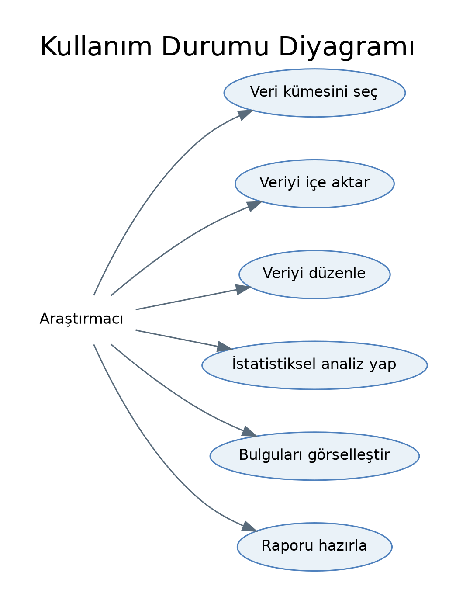
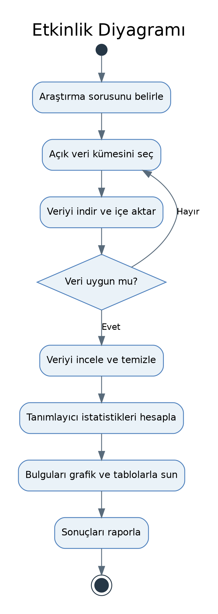
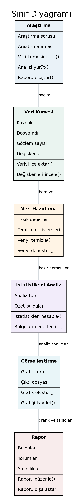

# Besin Takviyesi Kullanım Alışkanlıklarının ve Güvenli Kullanım Bilgisinin İncelenmesi

## Proje Hakkında

Bu proje, uygun ve kamuya açık bir veri kümesinden yararlanarak bireylerin besin takviyesi kullanım alışkanlıklarını incelemeyi amaçlamaktadır. Çalışmada, gözlemlenen kullanım örüntülerinin betimlenmesi ve seçilen veri kümesinde bulunan kullanıcı özelliklerine göre nasıl farklılaştığının değerlendirilmesi hedeflenmektedir.

Proje; Python, tanımlayıcı istatistikler ve veri görselleştirme kullanılarak yürütülecek, kapsamı yönetilebilir ve başlangıç düzeyine uygun bir veri analizi çalışması olarak planlanmaktadır. İlk aşamada makine öğrenmesi yöntemlerinin kullanılması veya yeni bir anket yapılması zorunlu değildir.

## Araştırma Sorusu

Açık veri setlerinde bulunan değişkenler çerçevesinde, besin takviyesi kullanım alışkanlıkları ve kullanıcı özellikleri arasında hangi örüntüler gözlenmektedir?

Çalışmanın nihai kapsamı, seçilen veri kümesinde bulunan değişkenlere bağlı olacaktır. Takviye kullanım nedenleri, sağlık profesyonellerine danışma durumu veya güvenli kullanım farkındalığına ilişkin bilgiler veri kümesinde yer almıyorsa analiz, mevcut verilerin ölçebildiği özelliklerle sınırlandırılacaktır.

Bu proje, bireylerin tıbbi açıdan besin takviyesine ihtiyaç duyup duymadığını belirlemeyi amaçlamamaktadır.

## Projenin Amaçları

- Besin takviyesi kullanımıyla ilişkili uygun bir açık veri kümesi belirlemek.
- Veri kümesinin dokümantasyonunu, değişkenlerini, kapsadığı dönemi, örneklemini ve kullanım koşullarını incelemek.
- Besin takviyesi kullanım alışkanlıklarını frekanslar, yüzdeler ve uygun özet istatistiklerle betimlemek.
- Bulguları açık ve anlaşılır görselleştirmelerle sunmak.
- Uygun olduğunda elde edilen bulguları ilgili bilimsel literatürle karşılaştırmak.
- Eksik bilgiler ve genellenebilirlik sınırları dâhil olmak üzere çalışmanın kısıtlılıklarını açıklamak.

## Olası Veri Kaynakları

Nihai veri kümesi henüz seçilmemiştir. Aşağıdaki kaynaklar ön değerlendirme amacıyla incelenecektir.

**1. Kaggle – Besin Takviyesi Kullanımına İlişkin Veri Setleri**

https://www.kaggle.com/datasets?search=dietary+supplement+use

**2. NHANES 2021–2023 – Beslenme Verileri**

https://wwwn.cdc.gov/nchs/nhanes/search/datapage.aspx?Component=Dietary&Cycle=2021-2023

Veri kümesi, değişkenleri ve dokümantasyonu araştırma sorusuyla uyum açısından incelendikten sonra seçilecektir.

## Planlanan Yöntem

1. Olası açık veri kümelerini araştırmak ve dokümantasyonlarını incelemek.
2. Araştırma sorusuyla ilişkili değişkenleri içeren uygun veri kümesini seçmek.
3. Verileri Python ortamına aktarmak.
4. Değişken tanımlarını, eksik değerleri, yinelenen kayıtları ve olası tutarsızlıkları incelemek.
5. Veri temizleme işlemlerini ve alınan kararları belgelendirmek.
6. Sayım, yüzde ve uygun özet ölçüler gibi tanımlayıcı istatistikleri hesaplamak.
7. Mevcut değişkenlere dayalı, anlaşılır grafikler oluşturmak.
8. Bulguları dikkatli biçimde yorumlamak ve veri kümesinin sınırlılıklarını açıklamak.
9. Sonuçları doğrulanmış bilimsel literatürle karşılaştırmak.

## Planlanan Araçlar

- **Python:** Veri işleme ve analiz
- **pandas:** Veri hazırlama ve özet tablolar
- **matplotlib veya seaborn:** Veri görselleştirme
- **Jupyter Notebook:** Analiz sürecini belgeleme
- **GitHub:** Sürüm kontrolü ve proje dokümantasyonu

Bu araçların kullanımı planlanmaktadır. Uygulama süreci, veri kümesi seçildikten sonra başlatılacaktır.

## Depo Yapısı

```text
dietary-supplement-use-analysis/
│
├── README.md
├── references.md
│
├── data/
│   └── README.md
│
├── notebooks/
│
└── reports/
```

Bu yapı başlangıç için önerilmiştir ve projenin ilerleyen aşamalarında güncellenebilir.

Seçilen veri kümesinin kullanım koşulları verilerin yeniden dağıtılmasını kısıtlıyorsa ham veri dosyaları GitHub deposuna yüklenmeyecektir. Bunun yerine veri kaynağı ve indirme yönergeleri belgelendirilecektir.

## Mevcut Durum

**Aşama:** Konunun belirlenmesi ve hazırlık

- Proje konusu ve ön araştırma sorusu belirlenmiştir.
- Olası veri kaynakları tespit edilmiştir.
- GitHub deposu oluşturulmuştur.
- Veri kümesinin seçilmesi, literatürün doğrulanması ve veri analizinin gerçekleştirilmesi henüz tamamlanmamıştır.
- Bu aşamada herhangi bir analiz sonucu sunulmamaktadır.

## Sonraki Adımlar

- DOI bilgileri mevcut olduğunda bunları da içerecek şekilde en az üç ilgili bilimsel yayını bulmak ve doğrulamak.
- Olası veri kümelerini ve değişken sözlüklerini incelemek.
- Araştırma sorusuna en uygun veri kümesini seçmek.
- Seçilen veri kümesini, kullanılacak değişkenleri ve araştırma kapsamındaki değişiklikleri README dosyasına eklemek.
- Python kullanarak keşifsel veri incelemesine başlamak.

## Sınırlılıklar

Çalışmanın kapsamı ve sonuçları; seçilen veri kümesine, örneklemine, besin takviyesi kullanımını ölçmek için kullanılan tanımlara ve değişkenlerin eksiksizliğine bağlı olacaktır.

Gözlemsel veriler ilişkileri ve örüntüleri ortaya koyabilir ancak tek başına nedensellik gösteremez. Ayrıca elde edilen sonuçlar, veri kümesinde temsil edilen nüfusun dışındaki gruplara genellenemeyebilir.

## Kaynakça

Literatür taraması tamamlandıktan sonra doğrulanmış bilimsel kaynaklar ve mevcut DOI bilgileri `references.md` dosyasına eklenecektir.

Nihai veri kümesi seçildiğinde ilgili veri kaynakları ve dokümantasyon bağlantıları da güncellenecektir.

## UML Diyagramları

Projenin analiz ve tasarım aşamasında üç UML diyagramı hazırlanmıştır.

### 1. Kullanım Durumu Diyagramı
Araştırmacının sistemde gerçekleştireceği temel işlemleri gösterir.



### 2. Etkinlik Diyagramı
Araştırmanın veri seçiminden raporlamaya kadar olan iş akışını gösterir.



### 3. Sınıf Diyagramı
Projenin temel bileşenlerini ve bu bileşenler arasındaki ilişkileri gösterir.


